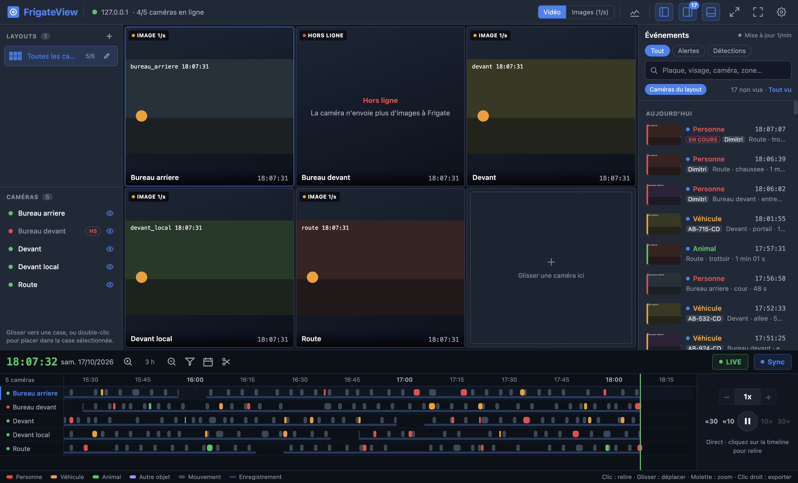
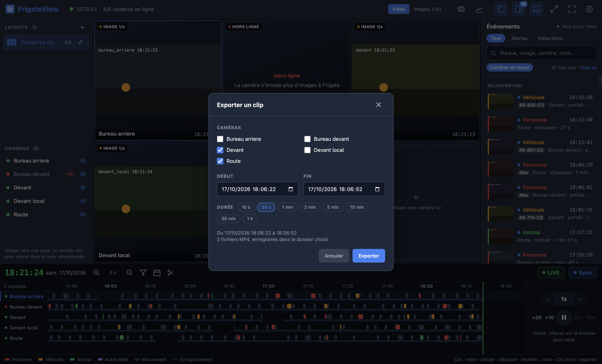

# 🎥 FrigateView

       

**Poste de surveillance de bureau pour Frigate NVR.** 📺
Vos caméras en direct, la relecture synchronisée, les événements et les murs vidéo multi-écrans, dans une vraie application Windows et macOS.



## 🎉 Fonctionnalités

- 📡 **Direct WebRTC** (go2rtc), repli automatique sur les images 1/s
- 🧩 **Layouts** : grilles de caméras par glisser-déposer, caméra agrandie, plein écran
- 🕰️ **Timeline** : enregistrements, mouvement, alertes ; relecture synchronisée de toutes les caméras, vitesse réglable, vignette au survol
- 🔔 **Événements** en temps réel : recherche (plaque, visage, zone), vus / non vus, détail avec clip
- 🖥️ **Murs vidéo** : un layout par écran, en vidéo ou en images, sans limite d'écrans
- ✂️ **Export de clips MP4** : plage début → fin, plusieurs caméras d'un coup, clic droit sur un événement de la timeline
- 📸 **Capture d'image** à la résolution d'origine
- 🔊 **Son** des caméras, 🕹️ **PTZ** (caméras motorisées ONVIF)
- 📊 **Statistiques** serveur et flux : CPU, débit, images par seconde
- 🔐 **Connexion sécurisée** : HTTPS, certificat auto-signé épinglé par empreinte, mot de passe chiffré par le système
- 🔔 **Notifications** du système, zone de notification, démarrage avec la session
- 🔄 **Mise à jour automatique** depuis les releases GitHub
- 🌍 **10 langues** : français, anglais, espagnol, portugais, russe, chinois, arabe, hindi, bengali, indonésien

## 🖼️ Aperçu

| Grille et événements | Export de clip |
|---|---|
|  |  |

> 📸 Captures prises sur le faux serveur de développement (`npm run mock`), images de test.

## 📍 Installation

Télécharger la dernière version : **[Releases](https://github.com/dimer47/FrigateView/releases/latest)**

| Système | Fichier |
|---|---|
| Windows 10 / 11 (x64) | `FrigateView-Setup-x.y.z.exe` |
| macOS puce Apple | `FrigateView-x.y.z-arm64.dmg` |
| macOS Intel | `FrigateView-x.y.z-x64.dmg` |

L'application n'est pas signée par un certificat payant :

- 🪟 **Windows** : alerte SmartScreen « éditeur inconnu » → *Informations complémentaires* → *Exécuter quand même*
- 🍎 **macOS** : premier lancement par clic droit sur l'app → *Ouvrir* → *Ouvrir*
- 🍎 Si macOS la dit « endommagée » : `xattr -dr com.apple.quarantine /Applications/FrigateView.app`

## 🔌 Connexion à Frigate

| Port | Mode |
|---|---|
| `8971` (recommandé) | HTTPS + compte Frigate (`admin` ou `viewer`) |
| `5000` | accès interne sans compte, déconseillé (avertissement affiché) |

- 🔑 Certificat auto-signé : empreinte affichée, à approuver une seule fois ; refus s'il change
- 💾 « Rester connecté » : mot de passe chiffré par le système (DPAPI, Trousseau), reconnexion automatique

## ⌨️ Raccourcis

| Raccourci | Action |
|---|---|
| `Espace` | lecture / pause |
| `Ctrl/Cmd + Maj + S` | capture d'image |
| `Ctrl/Cmd + Maj + E` | export de clip |
| `Ctrl/Cmd + Maj + M` | son |
| Clic droit sur la timeline | exporter l'événement visé |

## 🧮 Technique

- Electron 44 + electron-vite, Vue 3, Pinia, Tailwind CSS 4
- `code/src/main` processus principal : requêtes Frigate, certificats, fichiers, fenêtres et murs, menu, mises à jour
- `code/src/preload` pont `window.native` (sandbox, isolation du contexte)
- `code/src/renderer` interface : services Frigate et WebRTC, stores, composants
- Sécurité : requêtes limitées au serveur Frigate courant, navigation bloquée, Fuses Electron activés
- Releases : GitHub Actions construit Windows et macOS à chaque tag `v*`

## 🤝 Contribuer

```bash
cd code
npm install
npm run mock     # faux serveur Frigate (127.0.0.1:5050 sans compte, :5051 avec admin/admin)
npm run dev      # application en développement
npm test         # tests Vitest
```

- 📦 Paquets : `npm run dist:win`, `npm run dist:mac`
- 🌍 Traductions : `code/src/shared/locales/*.json`, le français est la langue source
- 📖 Détails : [`code/README.md`](code/README.md)

## 📄 Licence

- **AGPL-3.0-or-later** ([`LICENSE`](LICENSE)), avec deux conditions supplémentaires ([`ADDITIONAL_TERMS.md`](ADDITIONAL_TERMS.md)) qui s'appliquent aux copies et versions modifiées :
  - garder la mention d'origine du projet
  - signaler toute version modifiée comme « version alternative de FrigateView »
- Une version modifiée distribuée reste libre, avec son code source
- Composants tiers : [`THIRD_PARTY_NOTICES.md`](THIRD_PARTY_NOTICES.md), aussi dans l'app (Aide → À propos → Licences)
- Projet indépendant, sans lien avec les auteurs de [Frigate](https://github.com/blakeblackshear/frigate)
